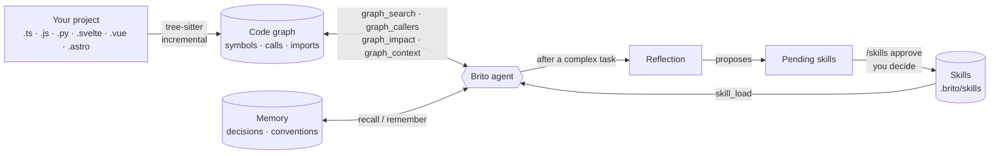

# Brito

**English** · [Português](README.pt-BR.md)

> A coding-agent CLI that knows your codebase as a **graph** and learns your project's procedures as **skills you review**.

Brito is a terminal agent for software development. Instead of grepping and reading files blindly, it keeps a **knowledge graph of your code** (symbols, who calls whom, who imports whom) and answers questions like *"what breaks if I change this?"* straight from the graph, in a fraction of a second. It also keeps **memory notes** and **skills**: reusable procedures learned from your own work, which only become active after **you** approve them.


*A real session on a small SvelteKit project: one question, two graph calls (0.1 s and 0.0 s), and an answer that already includes the `.svelte` components depending on the file. The status bar shows the real cost of the turn.*

## Highlights

- **Graph-first exploration.** `graph_search`, `graph_context`, `graph_callers`, `graph_callees` and `graph_impact` answer "where is it, who uses it, what breaks" without reading whole files. The graph is embedded ([Kùzu](https://kuzudb.com)), local and incremental.
- **Wide coverage.** TypeScript/JavaScript, Python and the script blocks of `.svelte`, `.vue` and `.astro` components. Import aliases (`tsconfig` paths, `package.json` imports, SvelteKit's `$lib`) become real edges. Files ignored by `.gitignore` stay out.
- **Skills that learn, with a human in the loop.** After a complex task Brito reflects on what happened and *proposes* skills. Nothing becomes active until you run `/skills approve`.
- **Safety rails for what gets learned.** A lint rejects secrets, credentials embedded in URLs, `curl | sh` and prompt-injection phrasing, and **warns about destructive commands** (see below).
- **Permission modes.** manual, auto-edits, plan and "everything allowed" (`Shift+Tab` cycles them). Even in the last one, skills are queued for review instead of being activated.
- **Two backends, one interface.** Use an Anthropic API key, or your Claude Code subscription through the `claude` CLI. Brito never reads or sends your subscription token.
- **Subagents.** `explore`, `plan` and `general` run in isolated contexts (read-only ones in parallel); add your own in `.brito/agents/*.md`.
- **MCP server.** `brito mcp-serve` exposes the graph, memory and skills to other MCP clients such as Claude Code. The query tools are marked `alwaysLoad`, so they are not hidden behind tool search.

## How it works



- **Code graph**: functions, classes, methods and components as nodes; `CALLS` and `IMPORTS` as edges. It re-parses only files whose hash changed and updates itself after edits.
- **Memory**: durable notes (decisions, conventions, bugs found) linked to files and symbols, retrieved with `recall`.
- **Skills**: step-by-step procedures for *your* project (commands, order, traps, how to verify). The agent loads one with `skill_load` before a task it covers.
- **Journal**: Brito remembers across sessions which tasks repeated, which is the best hint that a procedure is general and worth saving.

## Skills you review, not magic


1. A proposal appears in `/skills pending`, flagged when it contains destructive commands.
2. `/skills approve <name>` shows the **whole body** and the lint warnings, then asks for confirmation. That confirmation is required even in "everything allowed" mode.
3. Approved skills are versioned (`history/`), ranked by use, and flagged when the files they cite no longer exist. `/skills consolidate` merges duplicates and prunes unused ones.
4. A skill can be project-scoped or **global** (valid in every project); `/skills promote` moves one to global.

The lint **rejects** secrets/tokens, absolute user paths, credentials in URLs (`user:password@host`), `curl | sh`, and instructions to override rules or skip approval. It **warns** (without blocking) about commands that destroy data: removing database or data files, `DROP`/`TRUNCATE`, `DELETE` without `WHERE`, migration resets, `git reset --hard`, force-push, Docker volume removal. A skill is a standing instruction, so a step that was only safe in the state of one moment must not silently become the default.

## Install

Requires Node >= 20. Developed on macOS; Linux should work, Windows is untested.

```bash
# one line
curl -fsSL https://raw.githubusercontent.com/wilsonbrito/brito/main/install.sh | bash

# or straight from GitHub
npm i -g github:wilsonbrito/brito

# or cloning
git clone https://github.com/wilsonbrito/brito && cd brito
npm install && npm run build && npm link
```

Pick a backend:

```bash
export ANTHROPIC_API_KEY=sk-ant-...      # Anthropic API
# or: install Claude Code, run `claude` and /login — Brito will use your subscription
```

## Quick start

```bash
cd your-project
brito                       # opens the REPL
brito "who calls parseConfig?"   # single prompt, no REPL
brito index                 # (re)index the graph; it is also kept up to date automatically
brito query "MATCH (c:Symbol {kind:'component'})-[:CALLS]->(f:Symbol) RETURN c.file, f.name LIMIT 5"
```

A real `brito index` on the sample project above:

```
OK: 20 arquivos, 66 símbolos, 54 chamadas, 17 imports | +0 ~0 -0 =20 (28ms)
```


### Inside the REPL

| Command | What it does |
|---|---|
| `/help` | list commands |
| `/model`, `/effort`, `/reasoning` | choose model, reasoning effort and thinking (session, global or once) |
| `/modo` or `Shift+Tab` | switch permission mode: manual → auto-edits → plan |
| `/skills` | list skills · `pending` · `approve <name>` · `reject <name>` · `consolidate` · `rm <name>` · `promote <name>` |
| `/learn` | extract skills from the last turn now |
| `/agents`, `/tools`, `/index`, `/context` | inspect subagents, tools, the index and the context window |
| `!command` | run a shell command directly, without calling the model |
| `/clear`, `/exit` | clear the conversation, quit |

## What the graph indexes

- **Languages:** TypeScript/JavaScript (`.ts .tsx .mts .cts .js .jsx .mjs .cjs`), Python (`.py`) and the `.svelte`, `.vue` and `.astro` components. In components Brito reads the script block(s) (and Astro's frontmatter) and records calls made from the template to functions the script declares or imports; each component becomes a `component` symbol.
- **Scope:** inside a git repository, only what git considers part of the project (tracked + untracked-but-not-ignored), so anything in `.gitignore` stays out. Outside git, or with `BRITO_INDEX_IGNORED=1`, it indexes by glob (still skipping `node_modules`, `dist`, `build`, `.venv`, `.brito`).
- **Imports:** relative and aliased. Resolves `paths`/`baseUrl` from `tsconfig.json`/`jsconfig.json` (following relative `extends`, like `.svelte-kit/tsconfig.json`), `package.json` `imports` (`#internal/*`) and SvelteKit's `$lib`. Configuration applies per file (nearest config), so monorepos work; editing a tsconfig re-indexes the affected files.
- **Not yet:** `extends` by package (`@tsconfig/node20`), sibling-workspace `exports`, and function references without a call in a template (`onclick={fn}`). Calls are resolved statically with name-based fallbacks, so dynamic dispatch and reflection are not captured.

## Databases and other sensitive resources

Brito has **no database drivers and connects to nothing on its own**. When it needs to touch a database, it uses your project's own tooling through the shell, under the permission mode you chose. Because every project is different (a local file, a remote server, a container), declare the sensitive parts in `BRITO.md` (or `CLAUDE.md` / `AGENTS.md`), which is read into the system prompt:

```markdown
## Protected resources
- Database: local SQLite file `local.db` (never commit, never recreate).
  Test destructive changes on a copy: `cp local.db /tmp/test.db` and set `DATABASE_URL`.
  Schema changes: additive only, back up first (`cp local.db backups/pre-change.db`).
- Staging Postgres: connection string is in `$STAGING_DATABASE_URL` (read-only role). Never touch production.
```

- Credentials never belong in skills or notes: the lint rejects them. Cite the **name** of the environment variable instead.
- Prefer read-only roles and non-production environments when you give an agent database access.
- A proposed skill that contains a destructive command is highlighted at review time, so you decide whether it needs a guard (backup, copy, confirmation).

## Configuration

`BRITO_MODEL`, `BRITO_EFFORT`, `BRITO_EXPLORE_MODEL`, `BRITO_LEARN_MODEL`, `BRITO_HOME` (where global skills and history live), `BRITO_CONFIG`, `BRITO_COLOR`, `BRITO_INDEX_IGNORED`, `BRITO_SKILL_MIN_TOOLS` (how long a turn must be to trigger reflection when nothing else does).

Project data lives in `.brito/` (graph, project skills, agents) and global data in `~/.brito`. The graph, memory and skills stay on your machine; as with any coding agent, the code the model reads is sent to the model provider you configured.

## Limitations

- Early software (v0.1.0), one maintainer.
- **The interface and the agent's default language are Brazilian Portuguese.** Translating them is a welcome contribution.
- Skill learning is a heuristic: it proposes, you decide. Expect some proposals to be rejected.

## Development

```bash
git clone https://github.com/wilsonbrito/brito && cd brito
npm install
npm run dev          # runs via tsx
npm run typecheck
npm test             # 190+ tests, including a real MCP server and a real REPL
```

| Path | What |
|---|---|
| `src/graph/` | indexer (tree-sitter), `.svelte/.vue/.astro` support, import aliases, Kùzu store |
| `src/skills/` | store, lint, reflection, journal, consolidation |
| `src/agent/` | agent loop, prompts, subagents, `claude` CLI backend |
| `src/tools/` | graph, memory, skills, filesystem and shell tools |
| `src/mcp/` | MCP server |
| `src/repl.ts`, `src/ui/` | terminal interface |

## License

[MIT](LICENSE)
