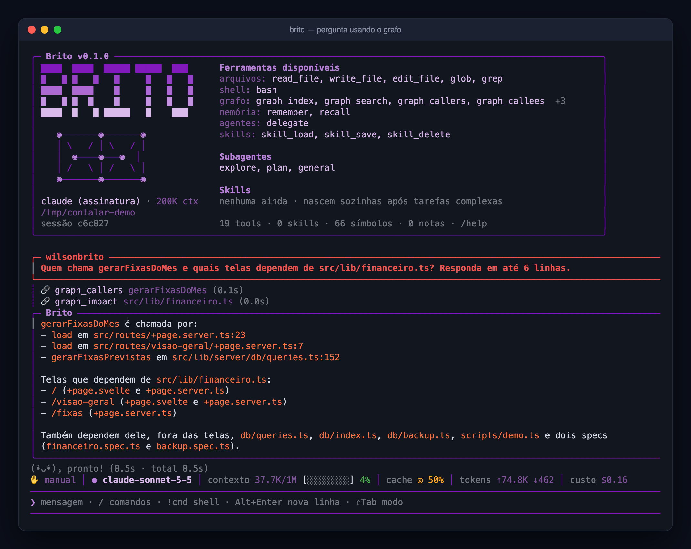
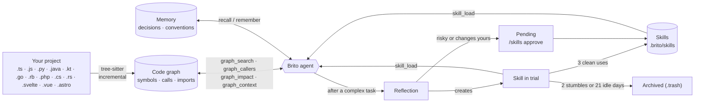
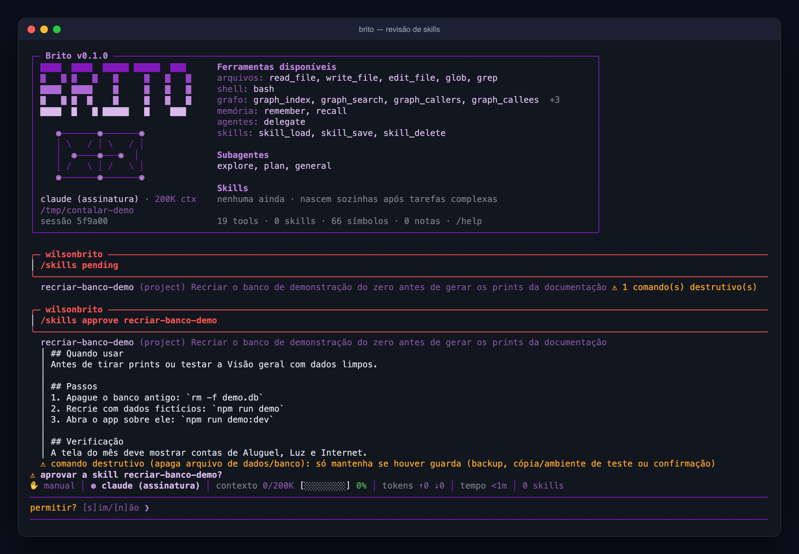
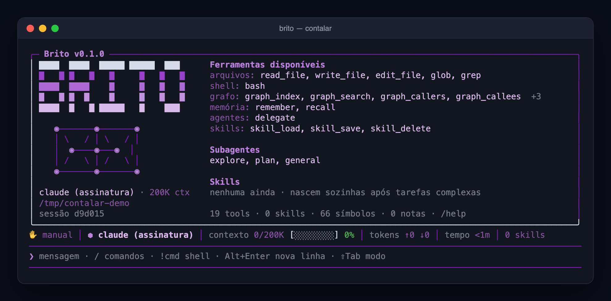

# Brito

**English** · [Português](README.pt-BR.md)

> A coding agent for your terminal (`brito-cli`) and your desktop (a native app) that knows your codebase as a **graph** and learns your project's procedures as **skills you review**.

Brito is an agent for software development. Use it in the terminal (`brito-cli` on npm) or as a desktop app (an executable for macOS, Windows and Linux): same agent, same graph, same skills. Instead of grepping and reading files blindly, it keeps a **knowledge graph of your code** (symbols, who calls whom, who imports whom) and answers questions like *"what breaks if I change this?"* straight from the graph, in a fraction of a second. It also keeps **memory notes** and **skills**: reusable procedures learned from your own work, which only become active after **you** approve them.



*A real session on a small SvelteKit project: one question, two graph calls (0.1 s and 0.0 s), and an answer that already includes the `.svelte` components depending on the file. The status bar shows the real cost of the turn.*

## Highlights

> **Upgrading to 0.6:** the graph engine changed from Kùzu (discontinued) to LadybugDB. The graph is rebuilt automatically on first use; your old `.brito/graph.kuzu` is kept. Brito asks once whether to copy your notes (memory) to the new graph, or run `brito migrar-notas` any time. Tests run in CI on macOS, Linux and Windows (use 0.6.1 or later on Windows/Linux). See the [CHANGELOG](CHANGELOG.md).

- **Graph-first exploration.** `graph_search`, `graph_context`, `graph_callers`, `graph_callees` and `graph_impact` answer "where is it, who uses it, what breaks" without reading whole files. The graph is embedded ([LadybugDB](https://github.com/LadybugDB/ladybug), fork mantido do Kùzu), local and incremental.
- **Wide coverage.** TypeScript/JavaScript, Python and the script blocks of `.svelte`, `.vue` and `.astro` components. Import aliases (`tsconfig` paths, `package.json` imports, SvelteKit's `$lib`) become real edges. Files ignored by `.gitignore` stay out.
- **Skills that learn on their own, on probation.** After a task that tripped or was corrected, Brito reflects and creates a skill *in trial* without interrupting you. A skill proves itself by use: 3 clean uses promote it, 2 stumbles archive it (recoverable). Anything risky, or any change to a skill you approved, still waits for your `/skills approve`. `BRITO_SKILLS=ask` restores approval-for-everything; `off` disables learning.
- **Safety rails for what gets learned.** A lint rejects secrets, credentials embedded in URLs, `curl | sh` and prompt-injection phrasing, and **warns about destructive commands** (see below).
- **Permission modes.** manual, auto-edits, plan and "everything allowed" (`Shift+Tab` cycles them). Autonomous skills do not depend on the mode: they are created in trial and judged by results.
- **Two backends, one interface.** Use an Anthropic API key, or your Claude Code subscription through the `claude` CLI. Brito never reads or sends your subscription token.
- **Terminal or desktop app.** `npm i -g brito-cli` gives you the `brito` command; the desktop app is a native executable with a window (projects and sessions in a sidebar, chat, permission prompts), no Node or terminal needed. See [Install](#install).
- **Images.** Drag an image file into the prompt (or paste its path) and it is attached to the turn: PNG, JPEG, GIF or WebP, up to 5 MB.
- **Subagents.** `explore`, `plan` and `general` run in isolated contexts (read-only ones in parallel); add your own in `.brito/agents/*.md`.
- **MCP server.** `brito mcp-serve` exposes the graph, memory and skills to other MCP clients such as Claude Code. The query tools are marked `alwaysLoad`, so they are not hidden behind tool search.

## How it works


*The graph is built once and updated incrementally; a question like "what breaks if I change this?" becomes one or two graph calls.*



- **Code graph**: functions, classes, methods and components as nodes; `CALLS` and `IMPORTS` as edges. It re-parses only files whose hash changed and updates itself after edits.
- **Memory**: durable notes (decisions, conventions, bugs found) linked to files and symbols, retrieved with `recall`.
- **Skills**: step-by-step procedures for *your* project (commands, order, traps, how to verify). The agent loads one with `skill_load` before a task it covers.
- **Journal**: Brito remembers across sessions which tasks repeated, which is the best hint that a procedure is general and worth saving.

### Architecture at a glance


*Everything the model sees or can do is one of eight components, grouped by role. The mono-spaced text is the real file or command; the pill says when it fires.*

## Skills that earn their place


*The two paths a skill can take. Safe ones prove themselves in trial; risky ones wait for your approval.*



0. **Autonomous path (default).** The reflection saves a new skill as *trial*, marked "(em teste)" in the index. Each turn that loads it counts as a win (no error-then-fix, no user correction) or a loss. 3 wins (and at most 1 loss per 3 wins) promote it; 2 losses without more wins, or 21 days unused, archive it to `.brito/skills/.trash`. Brito prints one line per promotion or archive. Limits: at most 3 new automatic skills a day, project scope only, and a weekly automatic consolidation that only touches automatic skills.
1. **Review path.** Skills with destructive commands, and changes to skills you approved, appear in `/skills pending`, flagged when they contain destructive commands.
2. `/skills approve <name>` shows the **whole body** and the lint warnings, then asks for confirmation. That confirmation is required even in "everything allowed" mode.
3. Approved skills are versioned (`history/`), ranked by use, and flagged when the files they cite no longer exist. `/skills consolidate` merges duplicates and prunes unused ones.
4. A skill can be project-scoped or **global** (valid in every project); `/skills promote` moves one to global.

The lint **rejects** secrets/tokens, absolute user paths, credentials in URLs (`user:password@host`), `curl | sh`, and instructions to override rules or skip approval. It **warns** (without blocking) about commands that destroy data: removing database or data files, `DROP`/`TRUNCATE`, `DELETE` without `WHERE`, migration resets, `git reset --hard`, force-push, Docker volume removal. A skill is a standing instruction, so a step that was only safe in the state of one moment must not silently become the default.

## Install

### Terminal (`brito-cli`)

Requires Node >= 20. Developed on macOS; Linux should work. On Windows use `npm i -g brito-cli` (the `install.sh` script needs bash); install Git for Windows so the `bash` tool runs bash commands, otherwise it falls back to `cmd.exe` (override with `BRITO_SHELL`).

```bash
# from npm (the command is `brito`)
npm i -g brito-cli

# or one line
curl -fsSL https://raw.githubusercontent.com/wilsonbrito/brito/main/install.sh | bash

# or straight from GitHub
npm i -g github:wilsonbrito/brito

# or cloning
git clone https://github.com/wilsonbrito/brito && cd brito
npm install && npm run build && npm link
```

Pick a backend:

```bash
export ANTHROPIC_API_KEY=sk-ant-...      # Anthropic API
# or: install Claude Code, run `claude` and /login — Brito will use your subscription
```

### Desktop app (executable)

The same agent in a window: projects and sessions in a sidebar, chat with markdown, collapsible tool calls, permission prompts, and pickers for model, effort and permission mode. It needs neither Node nor a terminal.


*The desktop app on a small project: one question, one graph call (the collapsed "ran 1 command" line), and the answer as a table. The sidebar groups sessions by project; the footer shows the backend, the folder, the context size and the cost.*

Download it from the [Releases page](https://github.com/wilsonbrito/brito/releases):

| System | File |
|---|---|
| macOS | `Brito-<version>-macos-arm64.dmg` (Apple Silicon) or `-x64.dmg` (Intel): open it and drag Brito to Applications |
| Windows | `Brito-<version>-windows-x64-setup.exe` |
| Linux | `Brito-<version>-linux-x64.tar.gz`: extract it and run `./install.sh` (adds Brito to the applications menu) |

The builds are not signed with an Apple Developer ID or a Windows certificate, so macOS ("unidentified developer": right-click, then Open) and Windows SmartScreen warn on the first launch. macOS is the platform exercised the most; the Windows and Linux builds come from CI and have had less testing.

Like the terminal version, it uses `ANTHROPIC_API_KEY` when your shell exports it, otherwise your Claude Code subscription (`claude`, then `/login`). Opened from the Finder, the app reads your login shell to find them.

To build it yourself: `npm run desktop` (development), `npm run desktop:app` (macOS: installs `/Applications/Brito.app`) or `npm run desktop:dmg`.

## Quick start

```bash
cd your-project
brito                       # opens the REPL
brito "who calls parseConfig?"   # single prompt, no REPL
brito index                 # (re)index the graph; it is also kept up to date automatically
brito query "MATCH (c:Symbol {kind:'component'})-[:CALLS]->(f:Symbol) RETURN c.file, f.name LIMIT 5"
```

A real `brito index` on the sample project above:

```
OK: 20 arquivos, 66 símbolos, 54 chamadas, 17 imports | +0 ~0 -0 =20 (28ms)
```



### Inside the REPL

| Command | What it does |
|---|---|
| `/help` | list commands |
| `/model`, `/effort`, `/reasoning` | choose model, reasoning effort and thinking (session, global or once) |
| `/fallback` | shows the main model and the fallback (qwen), and whether the switch already happened |
| `/modo` or `Shift+Tab` | switch permission mode: manual → auto-edits → plan → bypass ("everything allowed") |
| `/skills` | list skills · `pending` · `approve <name>` · `reject <name>` · `consolidate` · `rm <name>` · `promote <name>` |
| `/learn` | extract skills from the last turn now |
| `/agents`, `/tools`, `/index`, `/context` | inspect subagents, tools, the index and the context window |
| `!command` | run a shell command directly, without calling the model |
| `/clear`, `/exit` | clear the conversation, quit |

## What the graph indexes

- **Languages:** TypeScript/JavaScript (`.ts .tsx .mts .cts .js .jsx .mjs .cjs`), Python (`.py`), backend languages — Java (`.java`), Kotlin (`.kt`), Go (`.go`), Ruby (`.rb`), PHP (`.php`), C# (`.cs`), Rust (`.rs`) — and the `.svelte`, `.vue` and `.astro` components. In components Brito reads the script block(s) (and Astro's frontmatter) and records calls made from the template to functions the script declares or imports; each component becomes a `component` symbol.
- **Scope:** inside a git repository, only what git considers part of the project (tracked + untracked-but-not-ignored), so anything in `.gitignore` stays out. Outside git, or with `BRITO_INDEX_IGNORED=1`, it indexes by glob (still skipping `node_modules`, `dist`, `build`, `target`, `vendor`, `obj`, `.gradle`, `.venv`, `.brito`).
- **Imports:** relative and aliased. Resolves `paths`/`baseUrl` from `tsconfig.json`/`jsconfig.json` (following relative `extends`, like `.svelte-kit/tsconfig.json`), `package.json` `imports` (`#internal/*`) and SvelteKit's `$lib`. Configuration applies per file (nearest config), so monorepos work; editing a tsconfig re-indexes the affected files.
- **Backend languages:** the graph holds classes/interfaces/structs/traits/enums/modules, functions and methods (`Class.method`), calls and imports. Imports name a package, not a path, so Brito matches them against the end of your files' paths (`com.acme.Repo` ↔ `src/main/java/com/acme/Repo.java`; PHP PSR-4 namespaces; Rust `use crate::…`; Ruby `require`/`require_relative`; Go packages through the `go.mod` module path). External packages (`java.util`, `serde`, `github.com/gin-gonic/gin`) never match and create no edges. There is no type inference: a call like `userRepository.save()` is linked by matching the receiver name to a type in the project (`UserRepository`), `this`/`self`/receivers resolve to the enclosing class, and a bare call inside a class tries the class's own methods first.
- **Not yet:** `extends` by package (`@tsconfig/node20`), sibling-workspace `exports`, and function references without a call in a template (`onclick={fn}`). Calls are resolved statically with name-based fallbacks, so dynamic dispatch and reflection are not captured.

## Databases and other sensitive resources

Brito has **no database drivers and connects to nothing on its own**. When it needs to touch a database, it uses your project's own tooling through the shell, under the permission mode you chose. Because every project is different (a local file, a remote server, a container), declare the sensitive parts in `BRITO.md` (or `CLAUDE.md` / `AGENTS.md`), which is read into the system prompt:

```markdown
## Protected resources
- Database: local SQLite file `local.db` (never commit, never recreate).
  Test destructive changes on a copy: `cp local.db /tmp/test.db` and set `DATABASE_URL`.
  Schema changes: additive only, back up first (`cp local.db backups/pre-change.db`).
- Staging Postgres: connection string is in `$STAGING_DATABASE_URL` (read-only role). Never touch production.
```

- Credentials never belong in skills or notes: the lint rejects them. Cite the **name** of the environment variable instead.
- Prefer read-only roles and non-production environments when you give an agent database access.
- A proposed skill that contains a destructive command is highlighted at review time, so you decide whether it needs a guard (backup, copy, confirmation).

## OpenAI-compatible endpoint (e.g. Qwen on OCI)

> Full step-by-step (install, key, profile, and how to give people access to the repository, in Portuguese): [docs/GUIA-QWEN.md](docs/GUIA-QWEN.md).

Besides Claude, Brito runs on any model served through the OpenAI **Chat Completions** API (vLLM, OCI Generative AI, LiteLLM, Ollama…) with tool calling. Add a profile to `~/.brito/config.json`:

```json
{
  "providers": {
    "qwen": {
      "type": "openai",
      "label": "Qwen 27B (OCI)",
      "baseURL": "https://inference.generativeai.<region>.oci.oraclecloud.com/openai/v1",
      "model": "<model id; on OCI, the dedicated endpoint OCID>",
      "apiKeyEnv": "BRITO_QWEN_API_KEY",
      "contextWindow": 262144,
      "vision": false,
      "thinkingToggle": true
    }
  }
}
```

The key is **not** stored in the config: put it in the environment variable named by `apiKeyEnv`. Then:

```bash
brito --model qwen            # this session
/model qwen --global          # inside the REPL: make it the default
```

With a profile selected, **everything** goes to the endpoint: main agent, subagents (`explore` stops using Haiku), context summaries and skill learning; Brito starts without `ANTHROPIC_API_KEY` and without the `claude` CLI. `/reasoning none` turns the model's reasoning off (much faster answers on Qwen). `thinkingToggle: true` only for servers that accept `chat_template_kwargs` (vLLM/Qwen); without it `/reasoning none` has no effect, but no unknown parameter is sent. Images are only sent with `"vision": true`. Deliberate exception: `BRITO_EXPLORE_MODEL` still decides the `explore` subagent; a `BRITO_LEARN_MODEL` pointing at Claude is ignored while a profile is active. A broken profile in the config never falls back to Claude: Brito warns and stops. `/effort` stays exclusive to `claude` CLI mode, and a profile does not run inside the `claude` CLI (`/model` tells you to reopen with `--model`).

### Fallback to Qwen

With Claude as the main model (API or `claude` CLI), the `qwen` profile is the automatic fallback — always that one, no new config key. If Claude fails because of a **subscription limit, rate limit, credit, authentication, overload or network** error, Brito warns and redoes the request on Qwen with the conversation so far (tools that already ran stay in the history, so they are not repeated). In `claude` CLI mode the whole engine switches to Brito's own loop.

- The switch happens once per session and never reverts on its own: `/model <claude>` goes back to Claude (and the fallback can trigger again later).
- It does not switch on Ctrl+C or on content errors (invalid request, `max_tokens`, broken tool).
- Without `ANTHROPIC_API_KEY` and without the `claude` CLI, Brito opens straight on Qwen, with a warning. If the fallback is not ready, the usual error includes why (e.g. `BRITO_QWEN_API_KEY` is missing). An invalid `qwen` profile is still an error, never a silent fallback.
- `/fallback` shows the state. In the desktop app, send `/fallback` as a message; the status bar shows Qwen while the fallback is active.

## Configuration

`BRITO_MODEL`, `BRITO_EFFORT`, `BRITO_EXPLORE_MODEL`, `BRITO_LEARN_MODEL`, `BRITO_HOME` (where global skills and history live), `BRITO_CONFIG`, `BRITO_COLOR`, `BRITO_BANNER` (`compact` or `full`; default: full screen on windows of 95+ columns and 28+ rows), `BRITO_INDEX_IGNORED`, `BRITO_SKILL_MIN_TOOLS` (how long a turn must be to trigger reflection when nothing else does), `BRITO_SKILLS` (`auto` default, `ask`, `off`), `BRITO_SHELL` (shell used by the `bash` tool; on Windows defaults to Git Bash when installed).

Project data lives in `.brito/` (graph, project skills, agents) and global data in `~/.brito`. The graph, memory and skills stay on your machine; as with any coding agent, the code the model reads is sent to the model provider you configured.

## Limitations

- Early software (v0.5.0), one maintainer.
- The desktop app is new: a single window (no tabs yet), and with an API key (no `claude` CLI) the model does not resume a conversation after you reopen the app, although the screen shows it.
- **The interface and the agent's default language are Brazilian Portuguese.** Translating them is a welcome contribution.
- Skill learning is a heuristic: it proposes, you decide. Expect some proposals to be rejected.

## Development

```bash
git clone https://github.com/wilsonbrito/brito && cd brito
npm install
npm run dev          # runs via tsx
npm run typecheck
npm test             # 190+ tests, including a real MCP server and a real REPL
```

| Path | What |
|---|---|
| `src/graph/` | indexer (tree-sitter), `.svelte/.vue/.astro` support, import aliases, Ladybug (Kùzu) store |
| `src/skills/` | store, lint, reflection, journal, consolidation |
| `src/agent/` | agent loop, prompts, subagents, `claude` CLI backend |
| `src/tools/` | graph, memory, skills, filesystem and shell tools |
| `src/mcp/` | MCP server |
| `src/repl.ts`, `src/ui/` | terminal interface |
| `src/desktop/` | `brito gui-serve`: the backend the desktop window talks to (JSON over stdio) |
| `desktop/` | Electron window and packaging (`package.mjs`); `npm run bundle` builds the single-file backend it uses |

## License

[PolyForm Noncommercial 1.0.0](LICENSE): free to use, study and modify for any noncommercial purpose (personal use, research, education, hobby, nonprofits). Commercial use is not permitted. This is source-available, not OSI open source. Need a commercial license? Open an issue.
