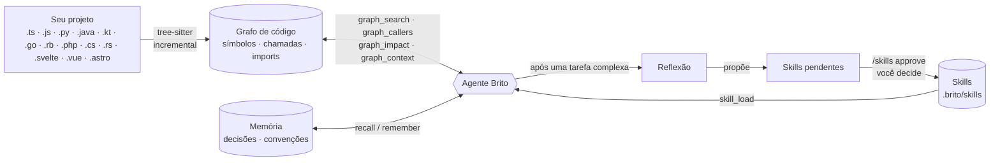

# Brito

[English](README.md) · **Português**

> Um agente de código para o seu terminal (`brito-cli`) e para o seu desktop (um app nativo) que conhece o seu projeto como um **grafo** e aprende os procedimentos dele como **skills que você revisa**.

O Brito é um agente para desenvolvimento de software. Use no terminal (`brito-cli` no npm) ou como app de desktop (um executável para macOS, Windows e Linux): o mesmo agente, o mesmo grafo, as mesmas skills. Em vez de dar `grep` e ler arquivos às cegas, ele mantém um **grafo de conhecimento do código** (símbolos, quem chama quem, quem importa quem) e responde perguntas como *"o que quebra se eu mudar isto?"* direto do grafo, em uma fração de segundo. Ele também guarda **notas de memória** e **skills**: procedimentos reutilizáveis aprendidos no seu próprio trabalho, que só passam a valer depois que **você** aprova.


*Uma sessão real num pequeno projeto SvelteKit: uma pergunta, duas consultas ao grafo (0,1 s e 0,0 s) e uma resposta que já inclui os componentes `.svelte` que dependem do arquivo. A barra de status mostra o custo real do turno.*

## Destaques

> **Atualizando para a 0.6:** o motor do grafo mudou do Kùzu (descontinuado) para o LadybugDB. O grafo é reconstruído sozinho no primeiro uso; o seu `.brito/graph.kuzu` antigo é mantido. O Brito pergunta uma vez se copia as suas notas (memória) para o grafo novo, ou rode `brito migrar-notas` quando quiser. Os testes rodam no CI em macOS, Linux e Windows (use a 0.6.1 ou posterior no Windows/Linux). Veja o [CHANGELOG](CHANGELOG.md).

- **Exploração guiada pelo grafo.** `graph_search`, `graph_context`, `graph_callers`, `graph_callees` e `graph_impact` respondem "onde está, quem usa, o que quebra" sem ler arquivos inteiros. O grafo é embutido ([LadybugDB](https://github.com/LadybugDB/ladybug), fork mantido do Kùzu), local e incremental.
- **Cobertura ampla.** TypeScript/JavaScript, Python e os blocos de script de componentes `.svelte`, `.vue` e `.astro`. Aliases de import (`paths` do tsconfig, `imports` do package.json, `$lib` do SvelteKit) viram arestas de verdade. O que o `.gitignore` ignora fica de fora.
- **Skills que aprendem sozinhas, em período de teste.** Depois de uma tarefa em que algo tropeçou ou foi corrigido, o Brito reflete e cria uma skill *em teste* sem te interromper. A skill se prova pelo uso: 3 usos limpos a promovem, 2 tropeços a arquivam (recuperável). O que é arriscado, ou qualquer mudança numa skill que você aprovou, continua esperando o seu `/skills approve`. `BRITO_SKILLS=ask` volta a pedir aprovação para tudo; `off` desliga o aprendizado.
- **Proteções sobre o que é aprendido.** Um lint rejeita segredos, credenciais embutidas em URL, `curl | sh` e frases de injeção de prompt, e **avisa sobre comandos destrutivos** (veja abaixo).
- **Modos de permissão.** manual, auto-edições, plano e "tudo liberado" (`Shift+Tab` alterna). As skills autônomas não dependem do modo: nascem em teste e são julgadas pelo resultado.
- **Dois backends, uma interface.** Use uma chave da API da Anthropic ou a sua assinatura do Claude Code pela CLI `claude`. O Brito nunca lê nem envia o token da sua assinatura.
- **Terminal ou app de desktop.** `npm i -g brito-cli` instala o comando `brito`; o app de desktop é um executável nativo com janela (projetos e sessões numa barra lateral, chat, pedidos de permissão), sem precisar de Node nem de terminal. Veja [Instalação](#instalação).
- **Imagens.** Arraste um arquivo de imagem para o prompt (ou cole o caminho) e ele é anexado ao turno: PNG, JPEG, GIF ou WebP, até 5 MB.
- **Subagentes.** `explore`, `plan` e `general` rodam em contextos isolados (os somente-leitura, em paralelo); crie os seus em `.brito/agents/*.md`.
- **Servidor MCP.** `brito mcp-serve` expõe grafo, memória e skills a outros clientes MCP, como o Claude Code. As tools de consulta são marcadas `alwaysLoad`, para não ficarem escondidas atrás da busca de tools.

## Como funciona


*O grafo é construído uma vez e atualizado de forma incremental; uma pergunta como "o que quebra se eu mudar isto?" vira uma ou duas chamadas ao grafo.*



- **Grafo de código**: funções, classes, métodos e componentes como nós; `CALLS` e `IMPORTS` como arestas. Só reparseia os arquivos cujo hash mudou e se atualiza sozinho após edições.
- **Memória**: notas duráveis (decisões, convenções, bugs descobertos) ligadas a arquivos e símbolos, recuperadas com `recall`.
- **Skills**: procedimentos passo a passo para o *seu* projeto (comandos, ordem, armadilhas, como verificar). O agente carrega uma com `skill_load` antes de uma tarefa que ela cobre.
- **Journal**: o Brito lembra entre sessões quais tarefas se repetiram, o melhor indício de que um procedimento é geral e vale guardar.

### Arquitetura em uma imagem


*Tudo o que o modelo vê ou pode fazer é um dos oito componentes, agrupados por papel. O texto em monoespaçado é o arquivo ou comando real; a etiqueta diz quando ele entra em ação.*

## Skills que merecem o lugar


*Os dois caminhos de uma skill. As seguras se provam em teste; as arriscadas esperam a sua aprovação.*


0. **Caminho autônomo (padrão).** A reflexão grava a skill nova como *em teste*, marcada "(em teste)" no índice. Cada turno que a carrega conta como vitória (sem erro→conserto nem correção do usuário) ou falha. 3 vitórias (e no máximo 1 falha a cada 3 vitórias) a promovem; 2 falhas sem mais vitórias, ou 21 dias sem uso, a arquivam em `.brito/skills/.trash`. O Brito imprime uma linha a cada promoção ou arquivamento. Limites: no máximo 3 skills automáticas novas por dia, só no escopo do projeto, e uma consolidação semanal automática que só mexe em skills automáticas.
1. **Caminho de revisão.** Skills com comandos destrutivos, e mudanças em skills que você aprovou, aparecem em `/skills pending`, sinalizadas quando contêm comandos destrutivos.
2. `/skills approve <nome>` mostra o **corpo inteiro** e os avisos do lint, e pede confirmação. Essa confirmação é exigida mesmo no modo "tudo liberado".
3. Skills aprovadas são versionadas (`history/`), ranqueadas por uso e sinalizadas quando os arquivos que citam deixam de existir. `/skills consolidate` junta duplicadas e poda as sem uso.
4. Uma skill pode ser do projeto ou **global** (vale em todos os projetos); `/skills promote` move uma para global.

O lint **rejeita** segredos/tokens, caminhos absolutos do usuário, credenciais em URL (`usuario:senha@host`), `curl | sh` e instruções para sobrepor regras ou pular aprovação. Ele **avisa** (sem bloquear) sobre comandos que destroem dados: apagar arquivos de banco ou de dados, `DROP`/`TRUNCATE`, `DELETE` sem `WHERE`, reset de migrações, `git reset --hard`, force push, remoção de volumes do Docker. Uma skill é uma instrução permanente, então um passo que só era seguro no estado de um momento não pode virar o padrão em silêncio.

## Instalação

### Terminal (`brito-cli`)

Requer Node >= 20. Desenvolvido no macOS; no Linux deve funcionar, no Windows não foi testado.

```bash
# pelo npm (o comando é `brito`)
npm i -g brito-cli

# ou uma linha
curl -fsSL https://raw.githubusercontent.com/wilsonbrito/brito/main/install.sh | bash

# ou direto do GitHub
npm i -g github:wilsonbrito/brito

# ou clonando
git clone https://github.com/wilsonbrito/brito && cd brito
npm install && npm run build && npm link
```

Escolha um backend:

```bash
export ANTHROPIC_API_KEY=sk-ant-...      # API da Anthropic
# ou: instale o Claude Code, rode `claude` e /login — o Brito usa a sua assinatura
```

### App de desktop (executável)

O mesmo agente numa janela: projetos e sessões numa barra lateral, chat com markdown, chamadas de ferramenta recolhíveis, pedidos de permissão e seletores de modelo, esforço e modo de permissão. Não precisa de Node nem de terminal.


*O app de desktop num projeto pequeno: uma pergunta, uma chamada ao grafo (a linha recolhida "executou 1 comando") e a resposta em tabela. A barra lateral agrupa as sessões por projeto; o rodapé mostra o backend, a pasta, o tamanho do contexto e o custo.*

Baixe na [página de Releases](https://github.com/wilsonbrito/brito/releases):

| Sistema | Arquivo |
|---|---|
| macOS | `Brito-<versão>-macos-arm64.dmg` (Apple Silicon) ou `-x64.dmg` (Intel): abra e arraste o Brito para Aplicativos |
| Windows | `Brito-<versão>-windows-x64-setup.exe` |
| Linux | `Brito-<versão>-linux-x64.tar.gz`: extraia e rode `./install.sh` (coloca o Brito no menu de aplicativos) |

Os pacotes não são assinados com Apple Developer ID nem com certificado do Windows, então o macOS ("desenvolvedor não identificado": botão direito, depois Abrir) e o SmartScreen do Windows avisam na primeira abertura. O macOS é a plataforma mais testada; os pacotes de Windows e Linux saem do CI e foram menos exercitados.

Como na versão de terminal, ele usa a `ANTHROPIC_API_KEY` se o seu shell a exporta; senão, a sua assinatura do Claude Code (`claude`, depois `/login`). Aberto pelo Finder, o app lê o seu shell de login para encontrá-las.

Para compilar você mesmo: `npm run desktop` (desenvolvimento), `npm run desktop:app` (macOS: instala `/Applications/Brito.app`) ou `npm run desktop:dmg`.

## Começando

```bash
cd seu-projeto
brito                       # abre o REPL
brito "quem chama parseConfig?"   # prompt único, sem REPL
brito index                 # (re)indexa o grafo; ele também se mantém atualizado sozinho
brito query "MATCH (c:Symbol {kind:'component'})-[:CALLS]->(f:Symbol) RETURN c.file, f.name LIMIT 5"
```

Um `brito index` real no projeto de exemplo acima:

```
OK: 20 arquivos, 66 símbolos, 54 chamadas, 17 imports | +0 ~0 -0 =20 (28ms)
```


### Dentro do REPL

| Comando | O que faz |
|---|---|
| `/help` | lista os comandos |
| `/model`, `/effort`, `/reasoning` | escolhem modelo, esforço de raciocínio e thinking (sessão, global ou uma vez) |
| `/modo` ou `Shift+Tab` | troca o modo de permissão: manual → auto-edições → plano → tudo liberado |
| `/skills` | lista skills · `pending` · `approve <nome>` · `reject <nome>` · `consolidate` · `rm <nome>` · `promote <nome>` |
| `/learn` | extrai skills do último turno agora |
| `/agents`, `/tools`, `/index`, `/context` | inspecionam subagentes, tools, o índice e a janela de contexto |
| `!comando` | roda um comando no shell direto, sem chamar o modelo |
| `/clear`, `/exit` | limpa a conversa, sai |

## O que o grafo indexa

- **Linguagens:** TypeScript/JavaScript (`.ts .tsx .mts .cts .js .jsx .mjs .cjs`), Python (`.py`), linguagens de backend — Java (`.java`), Kotlin (`.kt`), Go (`.go`), Ruby (`.rb`), PHP (`.php`), C# (`.cs`), Rust (`.rs`) — e os componentes `.svelte`, `.vue` e `.astro`. Nos componentes o Brito lê o(s) bloco(s) de script (e o frontmatter do Astro) e registra as chamadas feitas no template a funções que o script declara ou importa; cada componente vira um símbolo `component`.
- **Escopo:** em um repositório git, só o que o git considera parte do projeto (rastreados + novos não ignorados), então o que está no `.gitignore` não entra. Fora do git, ou com `BRITO_INDEX_IGNORED=1`, indexa por glob (ainda sem `node_modules`, `dist`, `build`, `target`, `vendor`, `obj`, `.gradle`, `.venv`, `.brito`).
- **Imports:** relativos e por alias. Resolve `paths`/`baseUrl` do `tsconfig.json`/`jsconfig.json` (seguindo `extends` relativo, como o `.svelte-kit/tsconfig.json`), `imports` do `package.json` (`#interno/*`) e o `$lib` do SvelteKit. A configuração vale por arquivo (a mais próxima), então monorepos funcionam; editar um tsconfig reindexa os arquivos afetados.
- **Linguagens de backend:** o grafo guarda classes/interfaces/structs/traits/enums/módulos, funções e métodos (`Classe.metodo`), chamadas e imports. Nelas o import nomeia um pacote, não um caminho; o Brito casa o especificador com o final do caminho dos seus arquivos (`com.acme.Repo` ↔ `src/main/java/com/acme/Repo.java`; namespaces PSR-4 do PHP; `use crate::…` do Rust; `require`/`require_relative` do Ruby; pacotes Go pelo módulo do `go.mod`). Pacote externo (`java.util`, `serde`, `github.com/gin-gonic/gin`) nunca casa e não gera aresta. Não há inferência de tipos: `userRepository.save()` é ligado casando o nome do receptor com um tipo do projeto (`UserRepository`), `this`/`self`/receiver resolvem para a classe que contém a chamada, e uma chamada solta dentro de classe tenta primeiro os métodos da própria classe.
- **Ainda não:** `extends` por pacote (`@tsconfig/node20`), `exports` de workspaces vizinhos e referências de função sem chamada em um template (`onclick={fn}`). As chamadas são resolvidas estaticamente, com fallback por nome, então despacho dinâmico e reflexão não são capturados.

## Bancos de dados e outros recursos sensíveis

O Brito **não tem drivers de banco e não se conecta a nada sozinho**. Quando precisa mexer em um banco, usa as ferramentas do próprio projeto pelo shell, sob o modo de permissão que você escolheu. Como cada projeto é diferente (um arquivo local, um servidor remoto, um container), declare as partes sensíveis no `BRITO.md` (ou `CLAUDE.md` / `AGENTS.md`), que é lido para o system prompt:

```markdown
## Recursos protegidos
- Banco: arquivo SQLite local `local.db` (nunca commitar, nunca recriar).
  Teste mudanças destrutivas numa cópia: `cp local.db /tmp/teste.db` e aponte `DATABASE_URL`.
  Mudanças de schema: só aditivas, com backup antes (`cp local.db backups/pre-mudanca.db`).
- Postgres de staging: a connection string está em `$STAGING_DATABASE_URL` (papel somente leitura). Nunca toque em produção.
```

- Credenciais nunca pertencem a skills ou notas: o lint as rejeita. Cite o **nome** da variável de ambiente.
- Prefira papéis somente leitura e ambientes que não sejam de produção ao dar acesso a banco para um agente.
- Uma skill proposta que contém comando destrutivo é destacada na revisão, para você decidir se precisa de uma guarda (backup, cópia, confirmação).

## Configuração

`BRITO_MODEL`, `BRITO_EFFORT`, `BRITO_EXPLORE_MODEL`, `BRITO_LEARN_MODEL`, `BRITO_HOME` (onde ficam skills globais e histórico), `BRITO_CONFIG`, `BRITO_COLOR`, `BRITO_BANNER` (`compact` ou `full`; padrão: tela cheia em janelas de 95+ colunas e 28+ linhas), `BRITO_INDEX_IGNORED`, `BRITO_SKILL_MIN_TOOLS` (tamanho mínimo do turno para disparar a reflexão quando nada mais dispara), `BRITO_SKILLS` (`auto` padrão, `ask`, `off`), `BRITO_SHELL` (shell da tool `bash`; no Windows usa o Git Bash se instalado).

Os dados do projeto ficam em `.brito/` (grafo, skills do projeto, agentes) e os globais em `~/.brito`. O grafo, a memória e as skills ficam na sua máquina; como em qualquer agente de código, o código que o modelo lê é enviado ao provedor de modelo que você configurou.

## Limitações

- Software em fase inicial (v0.5.0), um mantenedor.
- O app de desktop é novo: uma janela só (sem abas ainda) e, com chave de API (sem o `claude` CLI), o modelo não retoma a conversa ao reabrir o app, embora a tela a mostre.
- **A interface e o idioma padrão do agente são português do Brasil.** Traduzi-los é uma contribuição bem-vinda.
- O aprendizado de skills é heurístico: ele propõe, você decide. Espere rejeitar algumas propostas.

## Desenvolvimento

```bash
git clone https://github.com/wilsonbrito/brito && cd brito
npm install
npm run dev          # roda via tsx
npm run typecheck
npm test             # 190+ testes, incluindo um servidor MCP real e um REPL real
```

| Caminho | O quê |
|---|---|
| `src/graph/` | indexador (tree-sitter), suporte a `.svelte/.vue/.astro`, aliases de import, store Ladybug (Kùzu) |
| `src/skills/` | store, lint, reflexão, journal, consolidação |
| `src/agent/` | loop do agente, prompts, subagentes, backend da CLI `claude` |
| `src/tools/` | tools de grafo, memória, skills, arquivos e shell |
| `src/mcp/` | servidor MCP |
| `src/repl.ts`, `src/ui/` | interface de terminal |
| `src/desktop/` | `brito gui-serve`: o backend com que a janela do desktop conversa (JSON por stdio) |
| `desktop/` | janela Electron e empacotamento (`package.mjs`); `npm run bundle` gera o backend em arquivo único que ela usa |

## Licença

[PolyForm Noncommercial 1.0.0](LICENSE): uso, estudo e modificação livres para qualquer fim não comercial (uso pessoal, pesquisa, educação, hobby, ONGs). Uso comercial não é permitido. É código disponível (source-available), não open source pela definição da OSI. Precisa de licença comercial? Abra uma issue.
